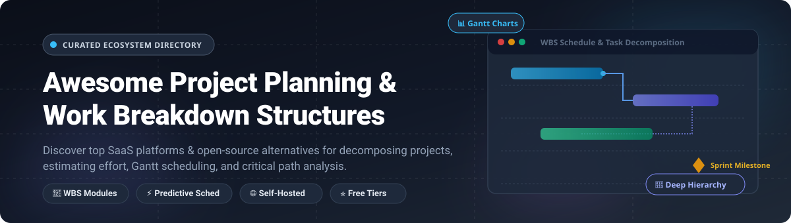

# Awesome-Project-Planning-Work-Breakdown

  

  
  
  
  
  
  

---

# 🚀 Awesome Project Planning &amp; Work Breakdown Structure (WBS)

> 🌟 **A comprehensive, SEO-optimized curated catalog of top Project Planning, Work Breakdown Structure (WBS), and Gantt Scheduling platforms** — featuring both enterprise SaaS/cloud solutions and self-hosted open-source alternatives for decomposing projects into hierarchical tasks, estimating effort, managing resource allocation, and tracking critical paths.
>
> 🌟 *Star this repository if you find it helpful for engineering teams, agile leaders, and project managers!* 🌟

---

## 📑 Table of Contents

- [🌐 Sector Overview &amp; Market Dynamics](#-sector-overview--market-dynamics)
- [🟦 SaaS / Hosted Platforms](#-saas--hosted-platforms)
- [🟩 Open-Source Software Solutions](#-open-source-software-solutions)
  - [Makeplane / Plane](#-makeplane--plane-)
  - [Mattermost Focalboard](#-mattermost-focalboard-)
  - [Super Productivity](#-super-productivity-)
  - [OpenProject](#-openproject-)
  - [Planka](#-planka-)
  - [Leantime](#-leantime-)
  - [Kanboard](#-kanboard-)
  - [Frappe Gantt](#-frappe-gantt-)
  - [Vikunja](#-vikunja-)
  - [Redmine](#-redmine-)
  - [Taskcafe](#-taskcafe-)
  - [Taiga](#-taiga-)
  - [GanttProject](#-ganttproject-)
  - [LibrePlan](#-libreplan-)
  - [ProjectLibre](#-projectlibre)
  - [Gnome Planner](#-gnome-planner)
- [📊 Feature Comparison at a Glance](#-feature-comparison-at-a-glance)
- [🤝 Contributing Guidelines](#-contributing-guidelines)
- [💖 Support &amp; Sponsorship](#-support--sponsorship)
- [📈 Star History](#-star-history)
- [📄 License](#-license)

---

## 🌐 Sector Overview &amp; Market Dynamics

The global project management and work planning software sector is valued at approximately **$9.8B to $10.5B (2024–2025)** and projected to expand at a **11%–15% CAGR** through 2030, accelerated by hybrid enterprise collaboration, automated resource allocation, and AI-driven predictive scheduling. 

The market dynamics exhibit a **moderately fragmented landscape**: while foundational tech conglomerates (like Microsoft) and prominent SaaS platforms (Smartsheet, Wrike) command dominant enterprise mindshare, intense specialization across agile developer tools, construction Gantt frameworks, and self-hosted open-source alternatives prevents a single winner-take-all monopoly.

---

## 🟦 SaaS / Hosted Platforms

Below is an overview of commercial, cloud-hosted Project Planning and Work Breakdown platforms, sorted in descending order by **Company Scale (Market Capitalization / Valuation / Revenue)**.

| 🏢 Platform | 💰 Company Valuation / Revenue Scale | 🏷️ Starting Paid Tier Pricing | 🎁 Free Tier Limit &amp; Free Trial Details | 🎯 Best For &amp; Key WBS / Gantt Capabilities |
| :--- | :--- | :--- | :--- | :--- |
| **Microsoft Project** | **~$3.1 Trillion Market Cap** (Microsoft Corp.) | **$10.00 / user / month** (Planner Plan 1 / Project Plan 1) | **No permanent free tier**; Offers a **30-day free trial** with full cloud feature access for up to 25 evaluation licenses | Enterprise-grade project scheduling, multi-level Work Breakdown Structures (WBS), deep resource leveling, and critical path analysis. |
| **Smartsheet** | **~$8.4 Billion Valuation** (Acquired by Blackstone &amp; Vista Equity) | **$9.00 / user / month** (Pro Plan, billed annually; max 10 users) | **Free Plan**: 1 user, up to 2 sheets, 500MB storage, 100 automation runs/mo; **30-day free trial** with no credit card required | Grid-driven work breakdown management, dynamic Gantt dependencies, critical path tracking, and automated team approval workflows. |
| **Wrike** | **~$2.25 Billion Valuation** (Acquired by Symphony Technology Group / STG) | **$9.80 / user / month** (Team Plan, billed annually; 2–25 users) | **Free Plan**: Unlimited users, 2GB cloud storage, web/desktop/mobile access, basic task lists; **14-day free trial** of Business/Enterprise plans | Mid-market and enterprise collaborative work breakdown, interactive Gantt charts, customized request forms, and workload balancing. |
| **LiquidPlanner** | **~$100 Million Valuation** (Division of Tempo Software / Diversis Capital) | **$15.00 / user / month** (Essentials Plan, billed annually) | **No permanent free tier**; Offers a **14-day fully-featured free trial** of the Ultimate tier (predictive scheduling, scenario modeling, unlimited tasks) | Dynamic, predictive scheduling engine that automatically calculates probabilistic completion dates and levels resource capacity based on priority. |
| **GanttPRO** | **~$10M–$20M Estimated Annual Revenue** (GanttPRO / XB Software) | **$7.99 / user / month** (Basic Plan, billed annually) | **No permanent free tier**; Offers a **14-day fully-featured free trial** with no credit card required, unlimited collaborators, and watermarked exports | Dedicated, intuitive interactive Gantt scheduling, milestone tracking, auto-scheduling dependencies, and real-time team workload tracking. |
| **TeamGantt** | **~$5M–$15M Estimated Annual Revenue** (TeamGantt) | **$49.00 / month flat** (Base Plan: 1 manager, 10 collaborators, 5 active projects) | **Free Forever Plan**: 1 manager, up to 2 collaborators, 1 active project, capped at 60 tasks maximum; **14-day free trial** of Business edition | Lightweight drag-and-drop Gantt chart planning with zero learning curve, baseline comparisons, and easy stakeholder view-only links. |

---

## 🟩 Open-Source Software Solutions

Community-driven, self-hosted, and transparent project planning, WBS, and Gantt tools. Ranked in descending order by **GitHub Star Count**.

### 🌟 [Makeplane / Plane](https://github.com/makeplane/plane) 
- **Tech Stack:** 🐍 Python / Django, ⚡ TypeScript / Next.js, 🐘 PostgreSQL, 🔴 Redis
- **Software License:** Apache-2.0
- **Primary Capabilities:** Modern, extensible open-source project management platform positioned as an open alternative to Jira, Linear, and Asana. Features hierarchical issue breakdowns, modules, work cycles, timeline/Gantt views, interactive analytics, and multi-tenant Docker deployment.
- **Best For:** High-velocity engineering and product teams seeking a responsive, self-hosted issue tracking and task decomposition workspace.

### 🌟 [Mattermost Focalboard](https://github.com/mattermost-community/focalboard) 
- **Tech Stack:** 🔷 Go (Golang), ⚡ TypeScript / React, 🐘 PostgreSQL / SQLite
- **Software License:** AGPL-3.0 / Apache-2.0
- **Primary Capabilities:** Multilingual, self-hosted project management workspace that serves as an alternative to Trello, Notion, and Asana. Supports Kanban boards, table calculations, calendar schedules, and gallery cards with custom schema properties and subtask grouping.
- **Best For:** Teams wanting a lightweight, privacy-first Notion/Trello alternative deployable standalone or integrated inside Mattermost.

### 🌟 [Super Productivity](https://github.com/super-productivity/super-productivity) 
- **Tech Stack:** ⚡ TypeScript / Angular, 💻 Electron (Desktop: Windows, macOS, Linux, Android)
- **Software License:** MIT
- **Primary Capabilities:** Advanced personal task manager, work break-down planner, and integrated time tracker. Features nested subtasks with individual time estimates, Pomodoro timers, break reminders, and direct sync connectors for Jira, GitLab, GitHub, and OpenProject.
- **Best For:** Developers, solopreneurs, and knowledge workers who need rigorous personal task breakdown, time tracking, and zero cloud lock-in.

### 🌟 [OpenProject](https://github.com/opf/openproject) 
- **Tech Stack:** 💎 Ruby on Rails, ⚡ Angular / TypeScript, 🐘 PostgreSQL
- **Software License:** GPL-3.0 (Community Edition)
- **Primary Capabilities:** Enterprise-grade open-source project portfolio and planning suite. Supports deep parent-child work package hierarchies, interactive Gantt timelines with automatic and manual scheduling modes, milestone baselines, cost budgeting, and agile boards.
- **Best For:** Mid-market to large organizations requiring full project lifecycle management, enterprise governance, and compliant European data privacy.

### 🌟 [Planka](https://github.com/plankanban/planka) 
- **Tech Stack:** ⚡ React, 🟢 Node.js, 🐘 PostgreSQL
- **Software License:** AGPL-3.0
- **Primary Capabilities:** Elegant, real-time kanban board tailored for agile teams. Provides nested task breakdowns through checklists, custom card labels, member assignments, file attachments, background custom styling, and SSO integration via OpenID Connect (OIDC).
- **Best For:** Small to medium engineering squads seeking an uncluttered, real-time visual collaboration tool with subtask progress tracking.

### 🌟 [Leantime](https://github.com/Leantime/leantime) 
- **Tech Stack:** 🐘 PHP, 🐬 MySQL / MariaDB, ⚡ JavaScript
- **Software License:** AGPL-3.0
- **Primary Capabilities:** Strategic project management system tailored for non-project managers and designed with cognitive accessibility in mind (supporting ADHD, dyslexia, and neurodiverse teams). Features goal alignment, milestone tracking, Gantt scheduling, SWOT analysis, and idea boards.
- **Best For:** Cross-functional startups, design agencies, and remote teams who find legacy PM platforms cumbersome and desire cognitive-friendly workflows.

### 🌟 [Kanboard](https://github.com/kanboard/kanboard) 
- **Tech Stack:** 🐘 PHP, 🗄️ SQLite / MySQL / PostgreSQL
- **Software License:** MIT
- **Primary Capabilities:** Minimalist, no-nonsense Kanban board focused on reducing cognitive overhead and visualizing Work In Progress (WIP). Supports subtask hierarchies with individual assignees, automatic workflow triggers, Gantt and analytics charts, and a rich plugin ecosystem.
- **Best For:** System administrators, DevOps teams, and technical project leads seeking an ultra-lightweight, zero-bloat board with simple single-file SQLite setup.

### 🌟 [Frappe Gantt](https://github.com/frappe/gantt) 
- **Tech Stack:** ⚡ Vanilla JavaScript, SVG, CSS
- **Software License:** MIT
- **Primary Capabilities:** Lightweight, dependency-free interactive Gantt chart library for the modern web. Features draggable task resizing, dependency line rendering, multiple time scales (Quarter Day, Half Day, Day, Week, Month, Year), and smooth SVG rendering.
- **Best For:** Software engineers looking to embed custom interactive Work Breakdown Structures and Gantt timelines directly into custom web applications.

### 🌟 [Vikunja](https://github.com/go-vikunja/vikunja) 
- **Tech Stack:** 🔷 Go (Golang), ⚡ TypeScript / Vue.js, 🐘 PostgreSQL / MySQL / SQLite
- **Software License:** AGPL-3.0
- **Primary Capabilities:** Highly customizable, modern to-do and work breakdown application. Offers five distinct views (List, Gantt chart, Kanban board, Table, and Calendar), limitless task nesting, recurring tasks, priority matrix tagging, and seamless CalDAV synchronization.
- **Best For:** Individuals and distributed groups seeking an agile, privacy-centric task organizer with native Gantt planning views.

### 🌟 [Redmine](https://github.com/redmine/redmine) 
- **Tech Stack:** 💎 Ruby on Rails, 🐘 PostgreSQL / MySQL / SQLite
- **Software License:** GPL-2.0
- **Primary Capabilities:** Battle-tested, enterprise open-source project management and issue tracker. Features flexible role-based access control (RBAC), multi-project support, subtask nesting, automatic Gantt and calendar views, issue tracking, and version control repository integration (Git/SVN).
- **Best For:** Established enterprise teams, software shops, and infrastructure engineers wanting an authoritative self-hosted platform with deep audit trails.

### 🌟 [Taskcafe](https://github.com/JordanKnott/taskcafe) 
- **Tech Stack:** 🔷 Go (Golang), ⚡ React / TypeScript, 🐘 PostgreSQL, GraphQL
- **Software License:** MIT
- **Primary Capabilities:** Open-source project management tool with a modern NextGen UI. Features kanban task grouping, checklist breakdowns, personal task lists, and activity logs powered by a clean Go/GraphQL backend.
- **Best For:** Developers who want an aesthetically pleasing, self-hosted NextGen alternative to Trello with checklist breakdown capabilities.

### 🌟 [Taiga](https://github.com/taigaio/taiga-docker) 
- **Tech Stack:** 🐍 Python / Django, ⚡ AngularJS, 🐘 PostgreSQL, 🐳 Docker
- **Software License:** MPL-2.0
- **Primary Capabilities:** Award-winning agile project management platform designed for cross-functional agile developers and designers. Features Scrum sprints, user story decomposition into modular subtasks, customizable Kanban workflows, and issue tracking.
- **Best For:** Agile engineering squads practicing Scrum or Kanban who need clear epic and user-story work breakdown decomposition.

### 🌟 [GanttProject](https://github.com/bardsoftware/ganttproject) 
- **Tech Stack:** ☕ Java / Swing Desktop (Windows, macOS, Linux)
- **Software License:** GPL-3.0
- **Primary Capabilities:** Free, cross-platform desktop project management application dedicated to Gantt scheduling and Work Breakdown Structures. Features hierarchical task trees, milestone baselines, PERT network generation, resource load calculations, and two-way Microsoft Project / Excel import-export.
- **Best For:** Solo project managers and engineering leads needing a standalone, offline desktop Gantt scheduling tool compatible with MS Project files.

### 🌟 [LibrePlan](https://github.com/LibrePlan/libreplan) 
- **Tech Stack:** ☕ Java / ZK Framework, 🐘 PostgreSQL
- **Software License:** AGPL-3.0
- **Primary Capabilities:** Enterprise-grade collaborative web application built specifically for deep Work Breakdown Structure (WBS) management. Allows nesting tasks in containers and subcontainers, complex resource allocation by competencies, worker holiday calendars, budget tracking vs. actuals, and JIRA connectors.
- **Best For:** Public sector organizations, municipal agencies, and engineering teams that require formal WBS decomposition and resource allocation without proprietary lock-in.

### 🌟 [ProjectLibre](https://github.com/smartqubit/projectlibre) 
- **Tech Stack:** ☕ Java Desktop (Cross-platform)
- **Software License:** CPAL 1.0 (Common Public Attribution License)
- **Primary Capabilities:** Renowned open-source desktop alternative to Microsoft Project with tens of millions of downloads worldwide. Provides multi-level WBS charts, Resource Breakdown Structures (RBS), Earned Value costing, and native `.mpp` file compatibility.
- **Best For:** Project planners seeking an immediate, drop-in desktop replacement for Microsoft Project on Windows, Linux, and macOS.

### 🌟 [Gnome Planner](https://gitlab.gnome.org/GNOME/planner) 
- **Tech Stack:** ⚙️ C / GTK+
- **Software License:** GPL-2.0
- **Primary Capabilities:** Native GNOME desktop project management tool grounded in Work Breakdown Structure methodologies. Features Gantt scheduling, task effort and duration estimations, resource leveling, and HTML export capabilities.
- **Best For:** Linux workstations and GNOME desktop users desiring an ultra-responsive native C/GTK project planning utility.

---

## 📊 Feature Comparison at a Glance

| 🛠️ Platform | 📜 License / Type | 💻 Tech Stack | 🌳 WBS Support | 📅 Gantt Engine | 👥 Resource Mgmt | 🏠 Self-Hosted | 🎯 Ideal Use Case |
| :--- | :--- | :--- | :--- | :--- | :--- | :--- | :--- |
| **Microsoft Project** | Proprietary SaaS / Desktop | Azure / Cloud / C++ | ✅ Full WBS Hierarchy | ✅ Advanced | ✅ Deep Resource Leveling | ❌ Cloud / Desktop Only | Large enterprises requiring formal PM standards |
| **Smartsheet** | Proprietary SaaS | Cloud Infrastructure | 🟡 Grid-based Hierarchy | ✅ Interactive | ✅ Capacity Planning | ❌ Cloud Only | Teams wanting spreadsheet ergonomics with PM power |
| **Wrike** | Proprietary SaaS | Cloud Infrastructure | ✅ Subtask Hierarchy | ✅ Dynamic Gantt | ✅ Workload Balancer | ❌ Cloud Only | Cross-functional marketing and IT operations |
| **LiquidPlanner** | Proprietary SaaS | Cloud Infrastructure | ✅ Priority Decomposition | ✅ Predictive Gantt | ✅ Dynamic Auto-Leveling | ❌ Cloud Only | High-uncertainty projects requiring predictive timing |
| **GanttPRO** | Proprietary SaaS | Web Cloud | ✅ Structured Hierarchy | ✅ Native Core | ✅ Workload View | ❌ Cloud Only | Dedicated Gantt-focused project planning |
| **TeamGantt** | Proprietary SaaS | Web Cloud | 🟡 Task Grouping | ✅ Drag-and-Drop | ✅ Light Workload | ❌ Cloud Only | Small teams desiring clean Gantt collaboration |
| **Plane** | Open-Source (Apache-2.0) | Python / TypeScript | ✅ Work Cycle &amp; Modules | ✅ Timeline View | 🟡 Member Allocations | ✅ Docker / Cloud | Agile software development teams |
| **Mattermost Focalboard** | Open-Source (AGPL-3.0) | Go / React | 🟡 Subtask Checklists | 🟡 Timeline Boards | 🟡 Member Assignments | ✅ Docker / Desktop | Visual collaboration and lightweight boards |
| **Super Productivity** | Open-Source (MIT) | TypeScript / Electron | ✅ Nested Subtasks | ❌ Timeline Plugin | ❌ Personal Focus | ✅ Local Desktop / Web | Personal productivity and developer time estimation |
| **OpenProject** | Open-Source (GPL-3.0) | Ruby on Rails / Angular | ✅ Deep Work Packages | ✅ Full Gantt Suite | ✅ Cost &amp; Hours Tracking | ✅ Docker / Packages | Enterprise self-hosted project governance |
| **Planka** | Open-Source (AGPL-3.0) | Node.js / React | 🟡 Task Lists &amp; Cards | ❌ Board Only | 🟡 Member Assignment | ✅ Docker | Real-time kanban workflow management |
| **Leantime** | Open-Source (AGPL-3.0) | PHP / MySQL | ✅ Subtasks &amp; Goals | ✅ Gantt &amp; Milestones | 🟡 Timesheet Tracking | ✅ Docker / LAMP | Neurodivergent and accessible team project management |
| **Kanboard** | Open-Source (MIT) | PHP / SQLite | 🟡 Subtask Breakdown | ✅ Plugin Gantt | 🟡 Assignee Limits | ✅ Single-File PHP | Minimalist, zero-overhead kanban tracking |
| **Frappe Gantt** | Open-Source (MIT) | JavaScript / SVG | 🟡 SVG Chart Library | ✅ Pure Gantt Engine | ❌ Library Only | ✅ Embeddable Component | Custom web software requiring embedded Gantt charts |
| **Vikunja** | Open-Source (AGPL-3.0) | Go / Vue.js | ✅ Deep Subtasks | ✅ Built-in Gantt | 🟡 Assignee Allocation | ✅ Docker / Binaries | Modern personal &amp; team to-do management |
| **Redmine** | Open-Source (GPL-2.0) | Ruby on Rails | ✅ Nested Issues | ✅ Built-in Gantt | ✅ Time &amp; Cost Module | ✅ Docker / Ruby Stack | Mature software bug tracking and project roadmap |
| **Taskcafe** | Open-Source (MIT) | Go / React | 🟡 Checklists &amp; Tasks | ❌ Board Only | 🟡 Member Assignments | ✅ Docker | Clean personal and team task management |
| **Taiga** | Open-Source (MPL-2.0) | Python / Django | ✅ Epics &amp; User Stories | 🟡 Sprint Timelines | 🟡 Sprint Capacity | ✅ Docker Compose | Scrum and Kanban software development |
| **GanttProject** | Open-Source (GPL-3.0) | Java / Desktop | ✅ WBS Task Trees | ✅ Native Gantt / PERT | ✅ Resource Load Charts | ✅ Desktop App | Free desktop scheduling with MS Project compatibility |
| **LibrePlan** | Open-Source (AGPL-3.0) | Java / PostgreSQL | ✅ Deep Hierarchical WBS | ✅ Gantt Scheduling | ✅ Skills-based Allocation | ✅ Web Docker | Public sector and enterprise WBS governance |
| **ProjectLibre** | Open-Source (CPAL-1.0) | Java / Desktop | ✅ Full WBS Breakdown | ✅ Full Gantt Engine | ✅ Resource Breakdown (RBS) | ✅ Desktop App | Direct desktop alternative to Microsoft Project |
| **Gnome Planner** | Open-Source (GPL-2.0) | C / GTK+ | ✅ WBS-based Breakdown | ✅ Native Gantt Views | ✅ Resource Leveling | ✅ Linux Desktop App | Native Linux desktop project scheduling |

---

## 🤝 Contributing Guidelines

Contributions, tool suggestions, and enhancements are warmly encouraged! 🎉

If you know of an outstanding open-source or notable SaaS Project Planning / Work Breakdown tool that should be included:
1. 🍴 **Fork** the repository.
2. 🌿 Create a new feature branch (`git checkout -b feature/add-new-tool`).
3. 📝 Add the tool following the existing tabular or badge format:
   - Tool name and repository / official URL
   - Tech stack and open-source license
   - Exact pricing tier and free tier / trial terms
   - Core differentiation and WBS / Gantt capabilities
4. 🚀 Ensure the tool is actively maintained (commits or releases within the past 12 months).
5. 📬 Submit a Pull Request with a clear description of why the tool stands out.

---

## 💖 Support &amp; Sponsorship

Thank you so much for exploring and using **Awesome Project Planning &amp; Work Breakdown**! 🌟

Maintaining this curated resource and tracking the fast-evolving ecosystem of SaaS platforms and open-source tools takes ongoing research, verification, and care. If you find this directory valuable for your engineering team, project management workflows, or architectural research, please consider supporting the project:

- ⭐ **Star the repository** to boost visibility on GitHub!
- 🍴 **Fork and contribute** by adding new tools, updating pricing tiers, or sharing feedback.
- 📢 **Share with peers** on Twitter/X, LinkedIn, Reddit, or developer Discord communities.
- ☕ **Buy a coffee &amp; sponsor ongoing development**: Support via the [GitHub Sponsor Dashboard](https://github.com/sponsors/ishandutta2007). Every contribution is deeply appreciated!

---

## 📈 Star History

---

## 📄 License

This repository and curated list are released under the [Creative Commons Zero v1.0 Universal](https://creativecommons.org/publicdomain/zero/1.0/) (CC0 1.0 - Public Domain). Individual projects and tools listed remain copyright and licensed under their respective holders.

---

  ⭐ <b>Found this resource valuable? Don't forget to star the repository to show support!</b> ⭐

